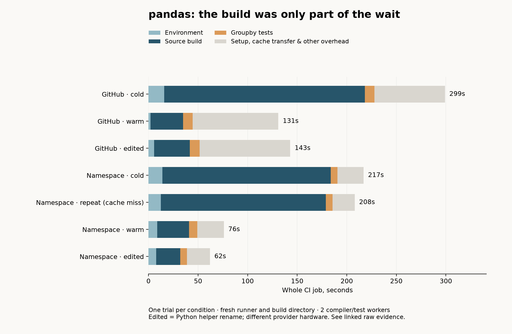

# A small pandas CI experiment on Namespace

**[Open the interactive demo](https://www.aarshroongta.com/demo/namespace)** — replay the actual runs, inspect each stage, and explore the cache miss.

I ran a pandas source build and **4,045 groupby tests** on GitHub and Namespace, using Linux runners with 4 vCPUs and about 16 GB RAM.

**The interesting result: once both caches were populated, the builds took almost the same time (~32 seconds), but the whole CI jobs took 131 seconds on GitHub and 76 seconds on Namespace.** Cache transfer and other setup work mattered more than the difference in warm compilation time.

| Measured step, with populated caches | GitHub | Namespace |
|---|---:|---:|
| Source build | 32.97 s | 32.09 s |
| Compiler-cache hits | 59 / 59 | 59 / 59 |
| Dependency/compiler cache restore or attach | 23 s | <1 s |
| Whole CI job | 131 s | 76 s |

Both runs passed **4,045 tests**, with 2 skipped. [GitHub run](https://github.com/aarshroongta1/namespace-ci-lab/actions/runs/45056009608) · [Namespace run](https://github.com/aarshroongta1/namespace-ci-lab/actions/runs/45056383722).

## What surprised me

The first repeated Namespace run passed its tests but started with **zero cached files**. It took 208 seconds; the later run with a populated cache took 76 seconds. Calling the second run “warm” would have given the wrong conclusion.

I checked that the runs used the same profile, cache tag, and write mode. Namespace [documents more frequent cache misses during onboarding](https://namespace.so/docs/architecture/storage/cache-volumes#cache-volume-onboarding), when a job can land on a node without the cached data. That is consistent with this observation; I did not inspect the private generation lineage to prove its specific placement cause.

I added `fail-on-cache-miss: true` for non-cold trials and checked the file count and ccache statistics. The next warm trial passed those checks and hit all 59 cacheable compiler calls.

**Small product suggestion:** surface “cache attached, but no reusable data” and the onboarding explanation prominently in the job summary. The action already logs the miss and links to the docs; a visible summary would make it easier for a first-time user to distinguish attaching a volume from benefiting from a warm cache.

## What I actually ran

- A pinned pandas revision, its existing locked Pixi `py312` environment, and an editable Meson source build.
- Two existing groupby test files, with two compiler processes and two pytest workers on both providers.
- Fresh runners, source checkouts, environment prefixes and build directories; only downloaded packages and ccache compiler outputs persisted.
- Cold and populated-cache runs on both providers, plus a small behavior-preserving Python helper rename as a follow-up (143 seconds on GitHub, 62 seconds on Namespace, with all 59 cacheable compiler calls hitting on both).

This is a small engagement experiment, **not a general performance benchmark**: one measured run per condition, different underlying hardware, and the full pandas CI matrix was not run. Whole-job times include checkout, apt setup, uploads and post-job work. For example, installing ccache took 24 seconds on the warm GitHub job versus 4 seconds on Namespace; the entire 55-second gap should not be attributed to cache attachment alone.

[Full results and run links](PANDAS_RESULTS.md) · [Workflow](.github/workflows/pandas.yml) · [Raw evidence](results/pandas/) · [Method and scope](METHODOLOGY.md) · [Pinned upstream CI](https://github.com/pandas-dev/pandas/blob/717bcd3eda554a0b2e826889f9e30efbd88f00cd/.github/workflows/unit-tests.yml)

[Method and reproduction details](METHODOLOGY.md) · [Short outreach draft](OUTREACH.md)
